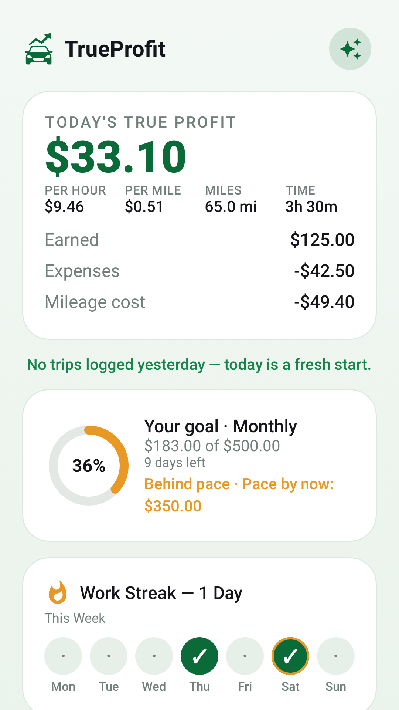
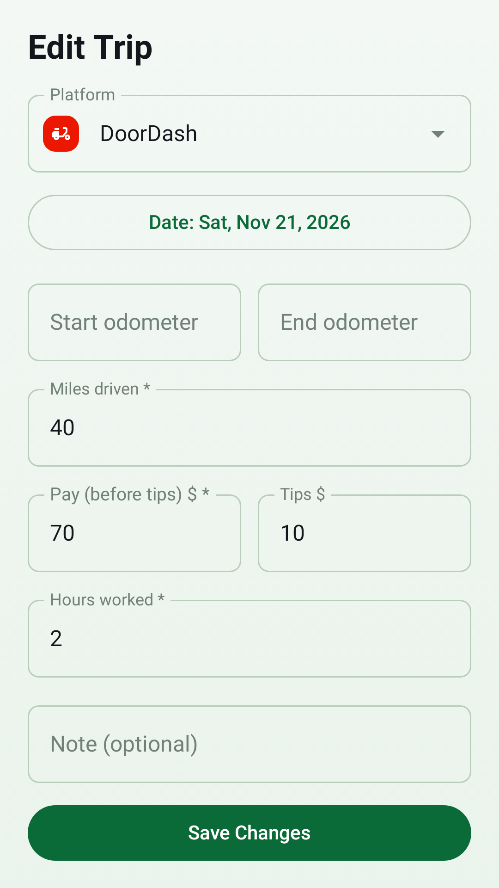
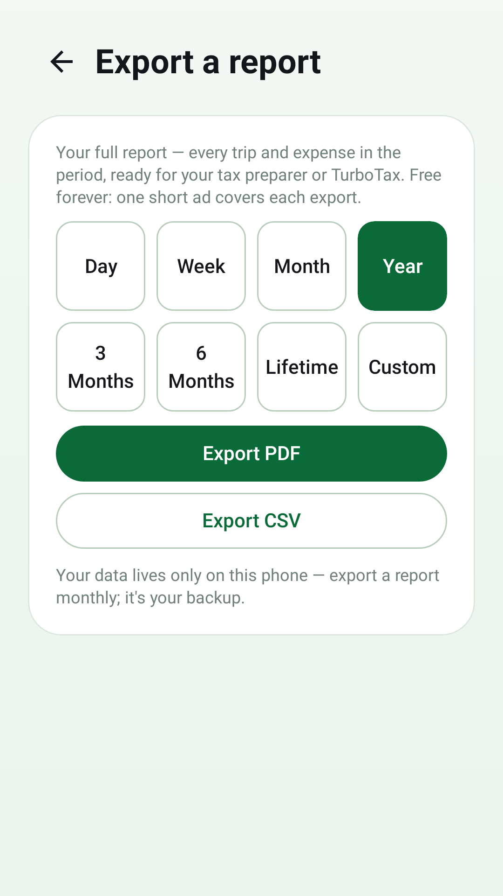
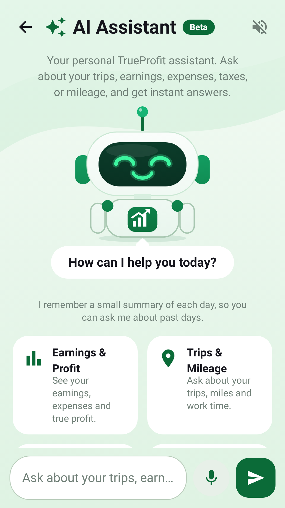
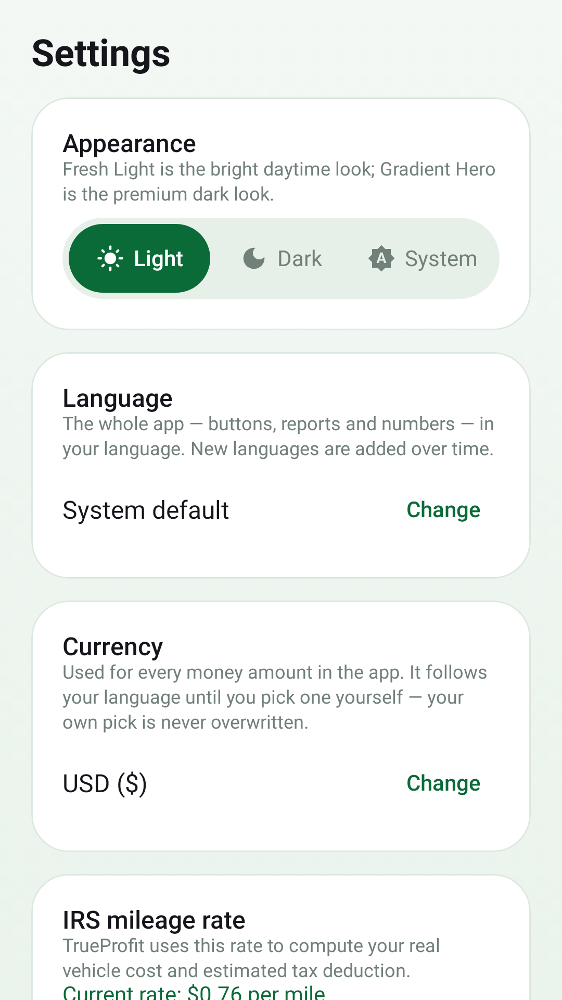
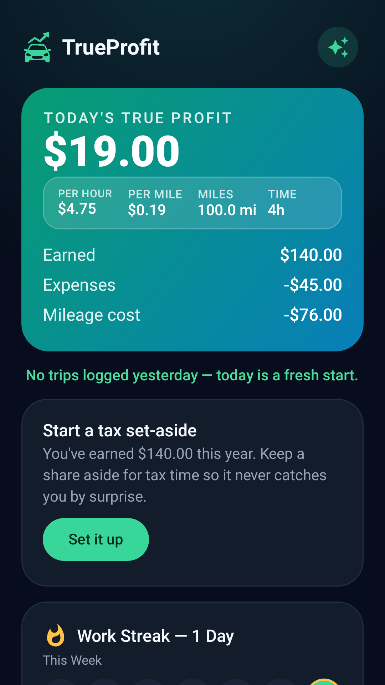
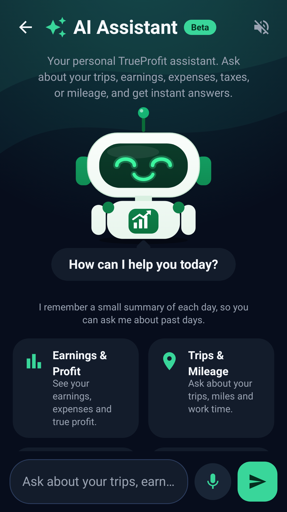
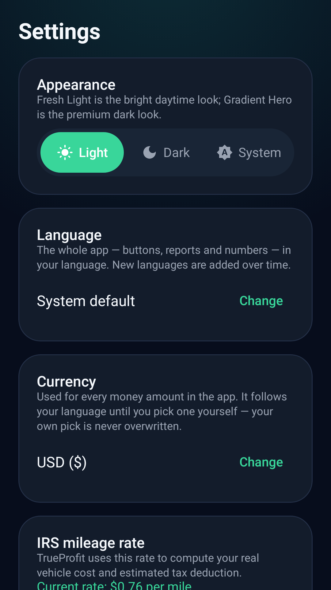

  

  
  
  
  
  

# Mileage Tracker: True Profit

**100% free mileage & TRUE profit tracker for gig drivers. No subscription.**

**100% FREE FOREVER — no subscription, no feature locks, no trial traps.**

See your TRUE profit — earnings minus expenses minus the real cost of every mile — as one big number, the moment you finish a shift.

Most mileage trackers show you what you EARNED. TrueProfit shows you what you actually KEPT. A $90 shift that cost $31 in mileage and $12 in fuel wasn't a $90 shift — it was a $47 shift. TrueProfit does that math for you, automatically, on every trip.

## What is TrueProfit?

TrueProfit is a free Android app that tracks your miles and shows your **TRUE profit** as a gig driver.

Most mileage trackers and driver apps show you what you *earned*. TrueProfit shows you what you actually *kept* — your pay minus fuel, expenses, and the real cost of every mile you drove (wear, tyres and maintenance, priced at the standard mileage rate for your country — such as the IRS standard mileage rate in the US). Log each trip in about 10 seconds, and your true profit, profit per hour and profit per mile update instantly.

With TrueProfit you can:

- **Track miles and trips** for DoorDash, Uber, Lyft, Uber Eats, Instacart, Walmart Spark, Amazon Flex and any other platform
- **See your real profit** after vehicle costs — not just gross earnings
- **Record expenses** like fuel, food, phone and maintenance, so no cost is missed
- **Export free tax reports** (PDF/CSV) with your deductible miles worked out at the standard mileage rate for your country (such as the IRS standard mileage rate in the US)
- **Work fully offline** — no account, no sign-up, no background GPS tracking, so no battery drain and no lost miles
- **Use it in 21 languages**, with the currency following your language and country

## Download & install

  

  <b><a href="https://github.com/adityasahind/trueprofit-releases/releases/download/v2.1.3/TrueProfit-v2.1.3.apk">Download TrueProfit-v2.1.3.apk</a></b> — free Android APK (about 5 MB), Android 8.0 and above. 
  Prefer the release page? Get it from <a href="https://github.com/adityasahind/trueprofit-releases/releases/tag/v2.1.3">the v2.1.3 release</a>.

**How to install the APK:**

1. Tap the download button above — the APK file downloads to your phone.
2. Open the downloaded `TrueProfit-v2.1.3.apk` file.
3. If Android asks for permission, allow **Install unknown apps** for your browser — this is the official TrueProfit release by Aadi Labs, published only in this repository.
4. Tap **Install**, open TrueProfit, and log your first trip in about 10 seconds.

SHA-256 of the v2.1.3 APK: `25b07d8bf2782554ecfb85312ed0117160e6d21ef3bb1e9441222479e1d0f181`

---

## Features — why drivers switch to TrueProfit

- **100% FREE, EVERY FEATURE** — unlimited trip history, full tax reports, everything. Other trackers lock your own data behind a $9.99/month paywall. TrueProfit doesn't: every feature is free, for every driver, forever.
- **ONE HERO NUMBER** — your TRUE profit is front and center, with profit per hour and profit per mile right beside it. No digging through menus to find the number that matters.
- **DEAD SIMPLE** — log a trip in about 10 seconds: platform, miles, pay, done. Big buttons, plain labels, zero clutter. Built for the driver's seat, not a desk.
- **NO ACCOUNT, NO LINKING, TOTAL PRIVACY** — no sign-up, no connecting your DoorDash or Uber account, no server. Everything stays on your phone. Your data is yours.
- **NO BATTERY DRAIN, NO LOST MILES** — TrueProfit never tracks you in the background, so it never eats your battery and never "forgets" a trip the way GPS auto-tracking does. You log it, it's saved. Forever.
- **FREE TAX REPORT** — your year-to-date deductible miles × the standard mileage rate for your country (such as the IRS rate in the US), always up to date. Export a clean, professional PDF or CSV for your tax preparer — free. Rivals charge a subscription for this.
- **AI ASSISTANT, 100% OFFLINE** — ask questions about your own numbers by chat or voice ("How much did I really make this week?") and get instant answers. The AI runs entirely on your phone — no internet needed, nothing leaves your device.
- **GOOGLE DRIVE BACKUP & RESTORE** — back up everything to your own Google Drive; switch phones and your complete data comes back with one restore.

## Made for gig drivers everywhere

DoorDash • Uber Eats • Instacart • Walmart Spark • Amazon Flex • and more — wherever you drive, in your country, your currency and your language.

## Your week in review

Every week, your dashboard tells the story: *"This week your TRUE profit was $212 — $38 more than last week. Best day: Friday."* Plus your day streak and your growing tax-deduction total, so every shift feels like progress.

## How it works

1. Finish a shift, tap **Log Trip** (10 seconds).
2. Add fuel, food and other expenses as they happen.
3. Watch your TRUE profit, profit/hour and profit/mile update instantly.
4. At tax time, export the report and hand it to your preparer.

The standard mileage rate for your country is built in as a dated schedule: when the official rate changes part-way through a year, every mile is counted at the rate of its own day — and you can edit the rate in Settings any time.

The app starts empty — your numbers only. Curious first? Tap **"See an example"** on an empty screen to explore with clearly-marked sample data, then **Start Fresh** to make it yours.

## What's inside

| Screen | What you see |
|---|---|
| **Dashboard** | "Your TRUE profit. One number." — earnings − expenses − mileage cost, instantly. Plus your week in review: beat last week, your best day, your streak. |
| **Log Trip** | Log a trip in 10 seconds — platform, miles, pay. Done. |
| **Tax view** | Your estimated tax deduction, adding up — every mile banked at your country's standard mileage rate, automatically. |
| **Reports** | A tax report preparers love — professional PDF/CSV export, free, no paywall. |
| **Expenses** | Every cost counted — fuel, food, phone, maintenance. Nothing missed. |
| **Settings** | No account. No tracking. Everything stays on your phone. |

**Also included:** earnings goals with a live progress ring, automatic Google Drive backup, a home-screen widget with today's TRUE profit, service reminders per vehicle, receipt photos, CSV import, and a fully offline Assistant that answers questions about your own numbers — in 21 languages.

## Screenshots

<small><b>Light theme</b></small>

  
  
  
  
  

<i>Dashboard · Log Trip · Reports · Assistant · Settings</i>

<small><b>Dark theme</b></small>

  
  
  

<i>Dashboard · Assistant · Settings — in the Gradient Hero dark theme</i>

## FAQ

**Is TrueProfit really free?**
Yes — 100% free. No subscription, no in-app purchases, no feature locks, no trial that expires. Every feature is free, for every driver.

**Do I need an account?**
No. There is no sign-up and no server — your trips, expenses and reports stay on your phone. If you want a backup, you can turn on automatic backup to your own Google Drive.

**Does TrueProfit work offline?**
Yes. TrueProfit works fully offline, and it never tracks you in the background, so it doesn't drain your battery or lose miles the way GPS auto-trackers can.

**Which drivers is TrueProfit made for?**
Any driver, anywhere in the world, who earns by the mile: DoorDash, Uber and Uber Eats, Lyft, Instacart, Walmart Spark, Amazon Flex, courier, delivery and taxi drivers.

**How is TrueProfit different from other mileage trackers?**
Other trackers show your earnings. TrueProfit subtracts your expenses and the real per-mile cost of running your vehicle, so the number you see is your TRUE profit — what you actually kept.

**Which Android versions are supported?**
Android 8.0 and above.

## Privacy

TrueProfit has no account, no server and no tracking. Your trips, expenses and reports live only on your phone (and in your own Google Drive, if you turn backup on). Read the full [Privacy Policy](https://adityasahind.github.io/trueprofit-privacy/).

*Estimates only — TrueProfit is a tracking tool, not tax advice. Consult a tax professional for your situation.*

---

  

  <b>Download TrueProfit and find out what you really earn.</b> 
  Free Android APK, v2.1.3 — Android 8.0 and above. Tap the button, install, and log your first trip in 10 seconds. 
  All versions: <a href="https://github.com/adityasahind/trueprofit-releases/releases">Releases</a>

<i>TrueProfit by Aadi Labs</i>

